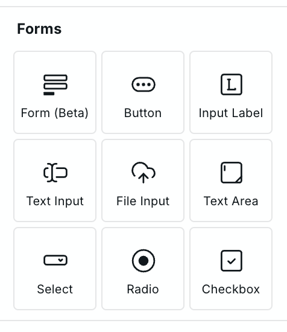
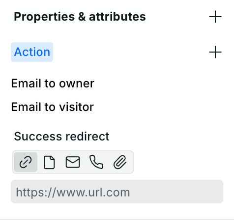
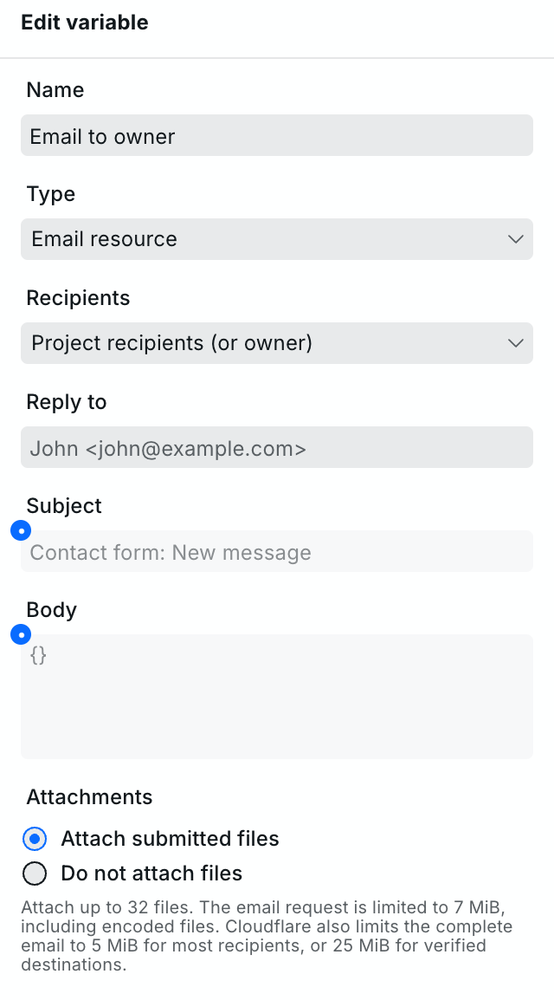
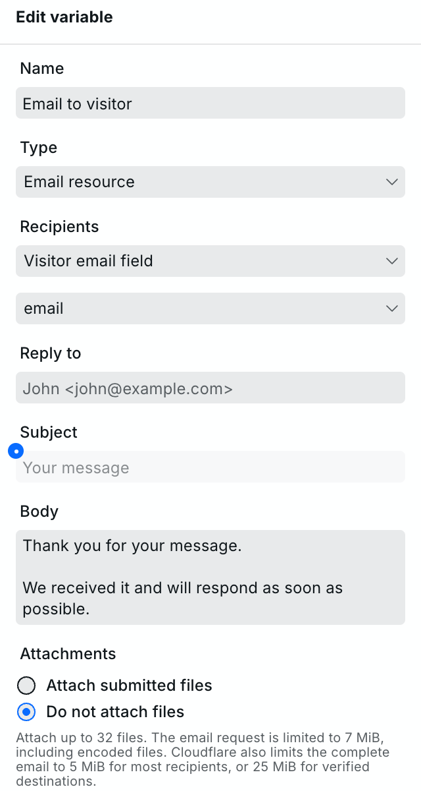
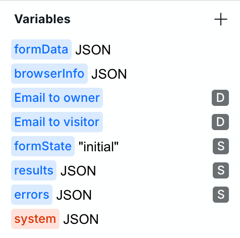

# Form

Form is a custom Webstudio component for collecting information without reloading the page. Use it to:

- Send data and files to an API.
- Send email notifications and visitor confirmations.
- Build search and filter forms that update URL query parameters.

A single submission can do several things at once. For example, it can email your team, confirm receipt to the visitor, and send the submitted data to another service.

**You can test all of this in Preview without publishing.**

For a basic HTML form with native browser behavior, insert an [Element](element.md) and set its tag to `form`.

## Start with a working contact form

Insert **Form (Beta)** from **Components > Forms**. On Webstudio Cloud, the default form is ready to use. It includes:

- Name, email, subject, and message fields.
- An optional file attachment.
- **Email to owner**, which sends the submitted information and page URL to your project recipients.
- **Email to visitor**, which sends a confirmation to the submitted email address.
- Editable success and error messages.
- An editable message while the Form is submitting.

If you haven’t configured project recipients, the owner notification goes to the account holder.

Open Preview and submit with an email address you control to try it. These defaults are a starting point: you can change the fields, customize the emails, or replace the actions entirely.

## Collect the information you need

Add fields inside the Form from **Components > Forms**. Each field needs a **Name**, which identifies its value when the form is submitted.

<figure>
  <picture>
    <source media="(prefers-color-scheme: dark)" srcset="../../.gitbook/assets/form-components-dark.png">
    
  </picture>
</figure>

For example, a field named `subject` becomes available in bindings as `formData.subject`. Its visible label can be different.

Fields can share a Name to collect multiple values, such as a group of checkboxes.

See the individual component guides for field settings:

- [Text Input and File Input](input.md)
- [Text Area](textarea.md)
- [Select](select.md)
- [Radio](radio-button.md)
- [Checkbox](checkbox.md)
- [Input Label](label.md)
- [Button](button.md)

## Send to several destinations

**Actions** define what happens when someone submits the Form. Each action uses a Resource, which contains the destination and its settings.

You can select up to **10 REST, GraphQL, or Email Resources**.

Select the Form and open **Settings > Properties & attributes > Action**:

- Click **+** to choose a Resource.
- Click an existing action to edit its Resource.
- Drag actions to change their order.
- Remove an action to stop using it on this Form. The Resource itself remains available.

<figure>
  <picture>
    <source media="(prefers-color-scheme: dark)" srcset="../../.gitbook/assets/form-actions-dark.png">
    
  </picture>
</figure>

If the list is empty, create a Resource in **Variables** first. You can select each Resource once.

Actions run in parallel. Reordering them changes the order of their results, not the order in which they run. One selected action cannot use another action’s response.

### Use submitted values

Create a Resource **on the Form** when it needs submitted values. You can then bind fields into its settings:

```text
"Contact form: " + (formData.subject ?? "New message")
```

Resources on ancestors or the global root can also be selected as actions, but they cannot bind this Form’s local variables.

### Send to an API

Choose a Resource type that matches your service:

- **REST:** configure the URL, headers, search parameters, body, and format.
- **GraphQL:** configure the URL, headers, query or mutation, and variables.

When used as Form actions, HTTP Resources send **POST** requests, regardless of their saved Method.

If an HTTP Resource has no configured body, the Form sends its submitted fields. This also works for Resources on ancestors or the global root. Set a custom body when you want to choose or transform the fields yourself. GraphQL uses its configured query and variables.

For REST Resources, **Format** controls how the body is sent:

| Format                | What it sends                                                                                                       |
| --------------------- | ------------------------------------------------------------------------------------------------------------------- |
| `auto`                | Plain text for text values, JSON for objects and arrays, or multipart form data when the body contains file fields. |
| `application/json`    | An object or array as JSON.                                                                                         |
| `multipart/form-data` | Fields and files as form data.                                                                                      |

Choose the format your API expects. Uploaded files need multipart form data; they cannot be sent as JSON.

See [Variables](../foundations/variables.md) for more about Resource settings and bindings.

## Customize email notifications

Email Resources can notify your team, confirm receipt to a visitor, or send different messages to different recipients. The default Form includes two emails, but you can edit or remove either one.

<figure>
  <picture>
    <source media="(prefers-color-scheme: dark)" srcset="../../.gitbook/assets/form-email-dark.png">
    
  </picture>
</figure>

### Choose recipients

| Recipients option                 | Who receives the email                                                        |
| --------------------------------- | ----------------------------------------------------------------------------- |
| **Project recipients (or owner)** | Addresses from project settings, or the account holder if that list is empty. |
| **Custom recipients**             | Addresses entered or bound on this Resource.                                  |
| **Visitor email field**           | The address submitted through the Form’s selected email input.                |

Use `Name <address>` to include a recipient’s name, such as `John <john@example.com>`. Separate multiple custom recipients with commas.

For a visitor confirmation, create the Email Resource on the Form. Its email input must have a fixed **Name** and a **Type** of `email` to appear in the field selector. The submitted value must contain one valid email address.

<figure>
  <picture>
    <source media="(prefers-color-scheme: dark)" srcset="../../.gitbook/assets/form-visitor-dark.png">
    
  </picture>
</figure>

### Set Reply to

**Reply to** determines where replies go. It accepts one address, optionally with a name, and supports bindings.

For an owner notification, you could use the visitor’s details so your team can reply directly:

```text
`${formData.name} <${formData.email}>`
```

Leave Reply to empty on the Resource to use the value from project settings.

The name in Reply to also identifies your organization in the default visitor confirmation. It appears in the subject and at the end of the message. Without a name, the default uses “Site Owner.”

Reply to does not change the sending email address used by Webstudio’s email service.

### Write the subject and message

Both **Subject** and **Body** support bindings. Use submitted fields to personalize the message, or `browserInfo.pageUrl` to include the page it came from.

To include all submitted fields, insert `formData` into the body:

```text
`Message from ${formData.name}

${formData}`
```

Webstudio turns the object into readable field names and values. Adding another named field then includes it automatically. Files appear as filenames; attaching the files is a separate setting.

Automatic formatting excludes password inputs and Webstudio’s internal fields. If an input’s Name or Type uses a binding, the automatic field list is omitted. Use explicit field bindings in that case.

The default visitor message thanks the visitor, confirms receipt, and ends with the name from Reply to. You can replace its subject and body with your own text.

Email bindings can use submitted fields and other available Variables, but cannot use another Resource’s response.

### Share defaults across forms

Set recipients and Reply to under **Project settings > Emails**.

- Choose **Project recipients** on a Resource to use the shared recipient list.
- Leave its **Reply to** empty to inherit the project value.
- Set either field on the Resource to override that default.

Subject and body belong to each Email Resource.

See [project email settings](../foundations/project-settings.md#emails).

## Send files

Add a **File Input** inside the Form and give it a **Name**. Use **Required**, **Accept**, and **Multiple** to configure the picker.

**Accept** helps visitors choose the right files. The receiving server must still validate their types.

Each action controls what happens to uploaded files:

- **Email:** choose **Attach submitted files** or **Do not attach files**.
- **HTTP API:** use multipart form data. The automatic format selects it when the body contains files.

The default owner email attaches files. The default visitor confirmation does not. An optional file input left empty sends no file.

See [Input](input.md) for field settings and [Limits and hosting](#limits-and-hosting) below for upload limits.

## Build search and filter forms

Remove all actions to switch the Form to **Navigation mode**.

Submitting now puts the named field values into the current page’s URL without a full reload. For example, submitting `chairs` through a field named `query` on `/products` produces:

```text
/products?query=chairs
```

A page Resource can use that value through a binding:

```text
system.search.query
```

Bind it to the Resource’s search parameter to load matching results. Add more fields for filters such as category or price.

Submission replaces the current query string. Include any parameters you want to keep as fields; hidden inputs work for this. Fields sharing a Name produce repeated query parameters.

Navigation mode does not use **Success redirect**. Use Resource actions when you need to upload files.

## Choose what happens after submission

The default Form contains four containers:

- **Form content** holds the fields.
- **Progress** shows a message while the Form is submitting.
- **Success message** appears after success.
- **Error message** appears after failure.

Their **Show** bindings use `formProgress.status` for Progress and `formState` for the other containers. By default, the fields remain visible while submitting and after a failure. Success hides the fields and shows the success message.

Select the message containers in Navigator to design them. To edit the Progress text, select its first Span child. Progress shows “Submitting…” and, when the browser measures the request, a short byte summary such as “1.2 MB / 3 MB”. The message stays visible while actions finish.

### Keep the fields visible

To keep the Form visible after success, select **Form content** and change its **Show** binding to an always-visible value.

A successful submission without a redirect resets fields to their default values. The default template has empty values, so visitors see an empty form again. You can show the success message alongside it.

On published dynamic sites, a successful submission also refreshes the current page’s Resources without reloading the page.

### Redirect to another page

Set **Success redirect** below the actions to send visitors to a thank-you page or another URL after success.

This setting is available when the Form has actions.

### Handle failures

All actions except visitor confirmation must succeed for the Form to show success. A failed visitor confirmation is recorded in `errors`, but does not make an otherwise successful submission fail.

Actions can succeed or fail independently. Your team might receive an email even when an API request fails. Check the individual results before submitting again.

Emails are not automatically resent when delivery is uncertain, to avoid duplicates.

## Use Form variables

The default Form provides these Variables on the Form and its children:

<figure>
  <picture>
    <source media="(prefers-color-scheme: dark)" srcset="../../.gitbook/assets/form-variables-dark.png">
    
  </picture>
</figure>

The screenshot predates `formProgress`; newly inserted Forms include it as shown below.

| Variable      | What it contains                                                                                 |
| ------------- | ------------------------------------------------------------------------------------------------ |
| `formData`    | Submitted values, keyed by field Name.                                                           |
| `browserInfo` | The page URL and available visitor details, such as browser, language, referrer, and IP address. |
| `formState`   | `initial`, `success`, or `error`.                                                                 |
| `formProgress` | Submission status, measured request bytes, and selected-file details.                         |
| `results`     | Action responses in order, including Resource name, HTTP status, and response body.              |
| `errors`      | Failed action details, including available status, response body, and error message.             |

Use `formData` and `browserInfo` to customize messages and requests. Use `formProgress.status` to show when a request is pending, `formState` for its outcome, and `results` and `errors` for action feedback.

`formProgress.status` is `pending` while files upload and actions run. It returns to `idle` when the submission finishes or is canceled. `formProgress.loaded` and `formProgress.total` start at `0`. They count bytes sent for the complete request, including fields and multipart encoding, when the browser can measure them. A `total` of `0` means the total is not yet known. Use `formProgress.loaded / formProgress.total` for a percentage only when `total` is greater than zero.

`formProgress.files` lists each selected file with `id`, `fieldName`, `name`, `size` (bytes), and `type` (MIME type). The browser does not provide reliable transferred byte counts for individual files in this request, so only the whole-request measurements appear in `formProgress.loaded` and `formProgress.total`.

When adding a binding inside a Form, autocomplete shows one example file so you can discover these fields. The example is only a suggestion in the editor; the actual `files` value remains empty until a submission includes files.

The default `formProgress` variable is added to newly inserted Forms. Existing Forms keep their current `formState` bindings and submission message. Navigation mode changes the URL without a managed submission, so it leaves `formProgress` idle with no files.

Create action Resources on the Form itself when they need these local bindings.

Available visitor details depend on the host and request. Referrer query parameters are removed, and an IP address is only included when the host provides a trusted source. `browserInfo` does not expose cookies, authorization, or raw request headers.

## Test without publishing

Preview lets you test the current draft, including emails, API requests, attachments, and redirects.

1. Open **Preview** and submit the Form.
2. Check the visible feedback and expected emails or API results.
3. Return to design mode and open an action’s Resource.

**Preview sends real emails and makes real requests.** Use addresses you control and test destinations.

The Resource inspector shows:

- **Request:** what was sent.
- **Response:** the returned status, headers, and body, where available.
- **Diagnostics:** additional execution details, when available.

Sensitive values are hidden, large output is limited, and files appear as metadata rather than their full contents.

Loading an Email Resource’s request preview does not send an email. Submit the Form in Preview to test delivery and capture its response.

Once the Form works as expected, publish it to update the site. Later Builder changes need to be published again.

## Limits and hosting

### Files and message sizes

Limits count the whole request or message, not each file separately.

| Limit | What it includes |
| ----- | ---------------- |
| **25 MiB per published Form submission** | The complete incoming multipart request: fields, files, and multipart encoding. |
| **4.5 MB per Preview Form submission** | The complete request: fields, files, and multipart encoding. Leave room for fields and encoding when choosing file sizes. |
| **25 MiB per outbound HTTP Resource body** | Webstudio's body-size check for a Form action. The destination or its network path may allow less. |
| **32 attachments per email** | All files attached to that email. |
| **7 MiB per email-service request** | The complete JSON request, including email text, attachment data encoded as Base64, and other fields. |

Multipart encoding adds bytes around each uploaded file and field. Base64 encoding makes attachments larger in the email-service request. Leave room for both when choosing file sizes.

[Cloudflare's email limits](https://developers.cloudflare.com/email-service/platform/limits/) list 5 MiB for a complete email, or 25 MiB for verified destination addresses. Those are provider limits, not guaranteed Form allowances: Webstudio's 7 MiB JSON limit and the incoming Form limit can stop a submission first. The final email includes its own encoding and headers.

### Sending limits

Webstudio Cloud allows up to **five team-recipient deliveries per submission**, plus one visitor confirmation Resource. Duplicate addresses count as separate deliveries.

An approximate limit of **50 recipient deliveries per project, per Cloudflare location, per minute** also applies. This is not a guaranteed cutoff. Preview and published sites have separate limits. Provider account limits may apply too.

If an email fails, check its response for the reported reason. See [Cloudflare’s email error reference](https://developers.cloudflare.com/email-service/api/send-emails/workers-api/#error-codes).

### Hosting

Resource actions need a server. Webstudio Cloud provides this; a static export cannot run them.

Self-hosted sites need a supported server setup and an email integration to send Email Resources. See [self-hosting](../self-hosting/README.md).

## Related

- [Variables](../foundations/variables.md) — Resources, scope, and bindings.
- [Project settings](../foundations/project-settings.md#emails) — Shared recipients and Reply to.
- [Input](input.md) — Field types and settings.
- [Element](element.md) — Basic HTML forms.
