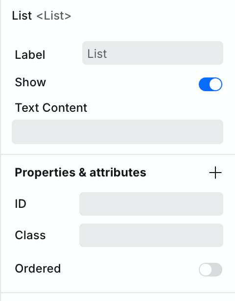

# 📃 List

> See [MDN: \<ul\>](https://developer.mozilla.org/en-US/docs/Web/HTML/Element/ul), [MDN: \<ol\>](https://developer.mozilla.org/en-US/docs/Web/HTML/Element/ol)



## Components

### List

The outer container — renders as `<ul>` (unordered) or `<ol>` (ordered) depending on the Ordered property.

### List Item

The individual item inside a List — renders as `<li>`. Existing List instances start with three List Item instances. Duplicate an existing one with **Cmd+D** / **Ctrl+D** to add more.

List Items can contain any component — text, images, links, buttons — making them suitable for rich, interactive lists beyond simple bullet points.

### How to use the List Component

The legacy List component is hidden from the default Components picker. For a new list, use the **Ordered List** or **Unordered List** template. Existing List instances can still be edited and contain three List Item instances by default.

To add more items to a legacy List, duplicate an existing List Item.

#### Duplicating List Items

You can quickly duplicate list items by selecting an item and pressing **Cmd+D** (Mac) or **Ctrl+D** (Windows).

#### Customizing Individual List Items

You can style individual list items differently from others by selecting a specific list item and applying styles or a design token to just that item. This is useful for highlighting specific items in your list.

#### Adding Content to List Items

List items can contain more than just text. You can drag other components like images, links, or buttons inside a list item to create rich, interactive lists.
Once the List Component is on your canvas, you can customize its appearance in the Style panel. For instance, you can change bullet point styles, numbering formats, spacing, and text properties.

#### List Style Type

You can customize the “List Style” for your List instance by going to “List Style Type” in the Style panel. There are several options, including Disc, Circle, Square and Decimal.

Setting the List Style Type allows you to define the appearance of the bullet points or numbering for list items, depending on the content’s context and your design choices. For example, you might choose “Decimal” for an ordered list of steps, but for a more decorative list, you could pick Disc or Circle.

---

### How to customize a List instance's properties in Webstudio

<figure><picture><source srcset="../../.gitbook/assets/list-component-properties-dark.png" media="(prefers-color-scheme: dark)"></picture></figure>

You can customize a List’s properties by selecting it and going to Settings. A fresh legacy List shows the Ordered property. To add Start or Reversed, click the “+” next to Properties and add that property.

#### Ordered

If you enable the Ordered property on your list, it will convert all list items to numbers and create an ordered list.

Ordered lists are commonly used for procedures, step-by-step guides, or any content that requires a defined sequence.

#### Start

The Start property sets the initial numbering value for ordered lists. It allows you to begin the list at a specific number, which is useful for scenarios where numbering should start from a custom value.

To use the Start property on your list, enable the ‘Ordered’ property first if your list items are in bullet points.

#### Reversed

The Reversed property reverses the order in which list items are numbered. This is effective for countdowns, rankings, or any content that benefits from a reverse order.

To use the Reversed property on your list, enable the ‘Ordered’ property first if your list items are in bullet points.

## Related

- [Collection](collection.md) – Dynamic lists from data
- [Paragraph](paragraph.md) – Text paragraphs
- [Separator](separator.md) – Divide content sections
