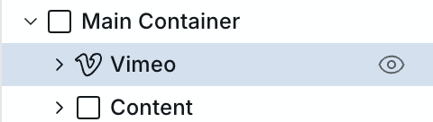
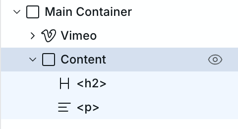
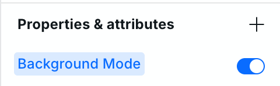
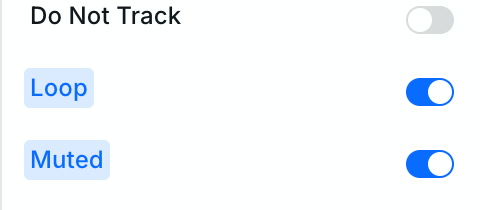
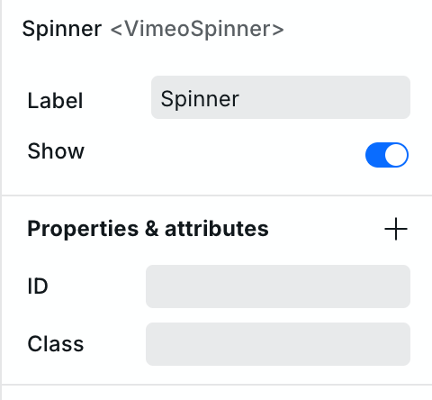

# ▶ Vimeo Background Video



## Here is how you can use the Vimeo Component as a background video on your site:

1. Start by adding a Box component (Main Container) to your site and set its position to “Relative.” 
2. Add a Vimeo component inside the Main Container.

   <figure><picture><source srcset="../../.gitbook/assets/vimeo-bg-video-step-2-dark.png" media="(prefers-color-scheme: dark)"></picture></figure>

3. After this, add another Box component (Content) inside the container and set its position to “Absolute.” This will stack the Content Box on top of the Vimeo instance. 
4. Now you can add any other content, like headings and paragraphs, to your Content Box, and it will be displayed over the background video.

   <figure><picture><source srcset="../../.gitbook/assets/vimeo-bg-video-step-4-dark.png" media="(prefers-color-scheme: dark)"></picture></figure>

5. Make sure to enable the “Background Mode” property for the Vimeo instance to ensure that your video starts automatically and all the video player controls are disabled.

   <figure><picture><source srcset="../../.gitbook/assets/vimeo-bg-video-step-5-dark.png" media="(prefers-color-scheme: dark)"></picture></figure>

And done! Now you have a background video on this section of your site.

## Here are some other changes you can make to optimize it further:

1. Enable the “Muted” and “Loop” properties for your Vimeo instance to have the background video play in a loop without any sound.

   <figure><picture><source srcset="../../.gitbook/assets/vimeo-bg-video-step-6-dark.png" media="(prefers-color-scheme: dark)"></picture></figure>

2. You can also hide or remove the Spinner on your output video for a more polished result. To hide it, select the Spinner instance from your Vimeo instance, head over to the Settings section and toggle off the “Show” option:

   <figure><picture><source srcset="../../.gitbook/assets/vimeo-bg-video-step-7-dark.png" media="(prefers-color-scheme: dark)"></picture></figure>

## Related

- [Vimeo](vimeo.md) – Standard Vimeo embeds
- [YouTube](youtube.md) – YouTube video embeds
- [Image](image.md) – Static background images
