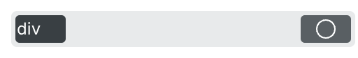
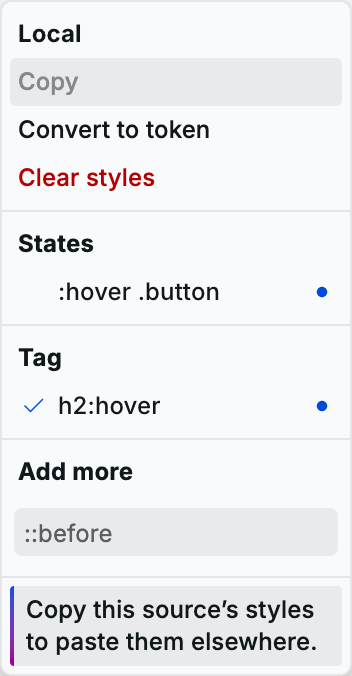
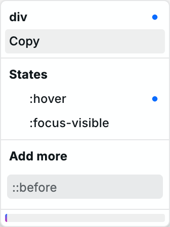

# 🏷️ Tag styles

**Tag styles** let you change the default appearance of an HTML tag across your site. For example, set the color of `h1` once to update every `h1` element. Tag styles extend Webstudio's preset styles for that tag.

## Add a Tag style

1. Select an instance on the canvas, such as a `div`.
2. Open the **Style sources** field at the top of the Style panel.
3. Select `div` under **Tag**. Its source appears first in the field.
4. Select that source and set a style. The Tag style is saved when you add its first style.

<picture>
  <source media="(prefers-color-scheme: dark)" srcset="../../.gitbook/assets/tag-style-source-dark.png">
  
</picture>

The source appears only while you work on the selected instance. If you select another instance and return, open the field to add it again. The saved style remains in the project and continues to affect every matching tag. Only the Tag style for the selected instance's HTML tag is offered. The Global root is the `html` tag and can also have a Tag style.

For example, select a Heading set to `h1`, add its Tag style, and change its color. Every `h1` on every page receives that color, including headings you add later. Select the Global root to edit the `html` Tag style, or select a Body to edit the `body` Tag style.

## Style tags inside a container

Use a **Local** source or a **Token** to style tags only inside a particular container:

1. Select the container and select its Local source, or add a Token to the container.
2. Open that source's menu and enter a tag such as `h2` under **Add more**.
3. Select the new tag selector and set its styles.

For a Token named `card` on the container, `h2` produces a selector like `.card h2`. It affects headings inside containers using that Token. A Local source scopes the rule to its one container. Headings elsewhere keep their own styles.

<picture>
  <source media="(prefers-color-scheme: dark)" srcset="../../.gitbook/assets/local-tag-selector-dark.png">
  
</picture>

## Style a state

Open the Tag style's menu and choose a state such as `:hover` or `:focus-visible`. Set styles while that state is selected. Select the state again to return to the tag's base styles.

<picture>
  <source media="(prefers-color-scheme: dark)" srcset="../../.gitbook/assets/tag-style-states-dark.png">
  
</picture>

A Tag style targets its tag and state across the site. In **Add more**, `:hover`, `[data-state=open]`, and `::before` target the source's own element. Enter an HTML tag to target a nested element: `h2`, `h2:hover`, `h2[a="123"]`, and `h2::before` are supported. For example, `div:hover` in the `div` Tag style targets every hovered `div`; `h2:hover` in a container's Local source targets hovered `h2` elements inside that container.

You can also use a state on the source's element followed by a descendant class: `:hover .button` styles descendants with class `button` while the source's element is hovered. `:hover > .icon` targets only direct children with class `icon`. These selectors are available in Tag, Token, and Local sources; each source determines the rule's scope. See [States and selectors](states-and-selectors.md#custom-states).

## Copy and paste

Open a Tag style's menu and choose **Copy**. Paste into the **Style sources** field in another project, or use the usual paste shortcut. Webstudio merges the copied styles into the Tag style for the same tag. Pasted values replace existing values for the same property, state, and breakpoint; other styles remain. No new Token is created.

## How Tag styles combine with other styles

The Tag style source stays first in the Style sources field. Tokens follow it, and Local is last. CSS specificity and source order determine which declaration applies when several sources set the same property. A rule for `h1` can lose to `.card h1` because the latter includes a class. A class-only rule on the heading can also lose to `.card h1`; attaching a Token or using Local does not automatically override a more specific nested rule. When selectors have equal specificity, later source order wins. Hover a property label to see its source under **Value comes from**.

Tag styles are separate from [Tokens](design-tokens.md). A Token applies to instances where you attach it; a Tag style applies to its HTML tag throughout the site without attaching it to an instance.

## Related

- [Style panel](style-panel.md) – Find and edit style sources
- [States and selectors](states-and-selectors.md) – Style hover, focus, and descendants
- [Design tokens](design-tokens.md) – Reuse styles on chosen instances
