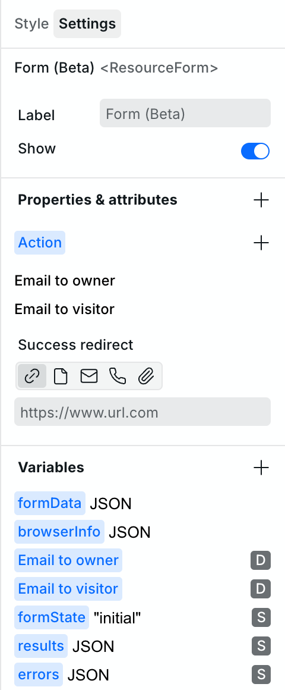

# 🔡 Variables


**Hint:** [CSS variables](css-variables.md) are different than data variables. They enable the reuse of values in the Style Panel.


Define variables on an instance in the Navigator, such as Global root, Body, or Heading. Find them in **Settings > Variables**.

<picture>
  <source media="(prefers-color-scheme: dark)" srcset="../../.gitbook/assets/variables-settings-panel-dark.png">
  
</picture>

## Variable scope

Variables are available within the instance they are defined on and any of its children. They are _not_ available in the parent.

If you define a variable on Global root, it is available on all pages and can be used within [Slots](../core-components/slot.md).


To access variables in the Page Settings, the variable must be defined on the Body of the page.


## Create and edit a variable

Select an instance in the Navigator, then use **Add variable** in **Settings > Variables**. In the **New variable** dialog, enter a **Name** and choose a **Type**. The name field suggests names already used in expressions but not yet created. Names must be unique on the same instance. You can reuse an ancestor's variable name, but a warning shows that the new variable shadows it.

Choose **String**, **Number**, **Boolean**, **JSON**, **REST resource**, **GraphQL resource**, **Assets resource**, **Email resource**, **Sitemap resource**, or **Current date resource**. Resource types may require a plan with dynamic data access. The editor changes with the type, and the right side of the dialog previews the value or resource data. You can resize or maximize the dialog.

Changes save when you close the dialog or move away from it. A new variable closes after it is created. Correct an invalid name before closing; other field errors are shown in their editors. For an existing variable, the menu offers **Copy** and, where allowed, **Delete**. Copying a resource includes its configuration, so you can paste it onto another instance or into another project. Resource editors also provide **Refresh resource data** and a **Refresh** menu action.

## Global variables

Variables defined on **Global root** are accessible across all pages. Use them for shared contact information, site settings, or resource configurations needed in [Slots](../core-components/slot.md).

### Setting up global variables

1. In the Navigator, select **Global root** above Body.
2. In **Settings > Variables**, select **Add variable**.
3. Enter a name and choose a type in the **New variable** dialog.

### Use cases



- **Contact email**: Define once and bind it to contact information across pages.
- **Simple CMS**: Use a JSON variable on Global root for data displayed in Slots.
- **Shared resource**: Define a resource once for use across pages.

## Variables

### System

The System variable is available by default. Forms also add variables automatically for submission data and state.

System variable contains the following:

- **Params** – Key/value pairs that are defined in Dynamic Page URLs.
- **Search** – Key/value pairs of query parameters that may exist in the URL.
- **Origin** – The URL of the current site. It will display whatever the actual URL is, so in the builder, it will be the internal wstd.io domain, but on the published site, it will be the current origin, likely a custom domain.
- **Pathname** – The current page's path (e.g., `/blog/my-post`). Useful for conditional logic based on the current URL.

### String

A String variable holds text data, which can be used for titles, descriptions, and labels. Enter the text in **Value**; the preview updates as you edit.

### Number

A Number variable stores numeric values, including integers and decimals. Enter a number in **Value**; the editor reports an empty or invalid number.

### Boolean

A Boolean variable represents a true or false value. Set **Value** with the switch, for example to control visibility.

### JSON

A JSON variable allows for structured data. Enter its value in the expression editor; syntax errors are marked there, and the evaluated value appears in the preview. It can provide items to a [Collection](../core-components/collection.md), such as a dynamic gallery.

### Resource

Choose **REST resource** to fetch data from an HTTP API. For a GraphQL API, use the [GraphQL resource](variables.md#graphql) editor.

There are several fields available to configure the fetch request.


**Shortcut:** The URL field supports pasting in a cURL command. Doing so will automatically populate the various fields within the Resource. Many API docs will provide you with a cURL command, so look out for it to save time.


- URL – Where the resource is located.
- Method – GET, POST, PUT, or DELETE. Refer to the third-party API docs to find the suitable method.
- Search params – Key/value pairs used for providing additional parameters as part of the URL. Values can be bound to other variables.
- Cache max age – Define your own cache lifetime.
- Headers – Key/value pairs such `Content-Type application/json`. Refer to [Request Headers](https://developer.mozilla.org/en-US/docs/Glossary/Request_header) for more info.
- Format and body – For requests other than GET, choose **auto**, **application/json**, or **multipart/form-data** and configure the body. A Form action also shows these fields even when GET is selected because Form submissions use POST.

The preview can load the request and show its response, request details, and error diagnostics. Use **Refresh resource data** after changing inputs or to request fresh data.



#### Submit a form to a resource

A new [Form](../core-components/form.md) includes two email resources. To add another destination, create a REST, GraphQL, or email resource in **Variables** on the Form or an ancestor. Then select the Form and use **Properties & Attributes > Action** to add the resource. Resources defined on the Form can bind to its `formData` and safe `browserInfo` values; ancestor resources cannot bind to those values. HTTP destinations always send POST requests when the Form is submitted, regardless of their configured method for ordinary data loading.

The Form also exposes `formState`, `results`, and `errors` in **Variables**. Use these to show the submission state and inspect the selected actions' responses. See the [Form guide](../core-components/form.md#inputs-and-responses) for their contents and submission behavior.

For a Form-scoped HTTP resource, leave the body unset to forward every named Form field. **Format** defaults to **auto**: text-only Form data is JSON; a body containing uploaded files becomes multipart. Choose **application/json** or **multipart/form-data** when the receiving API requires that format. JSON rejects uploaded files instead of dropping them. Multipart sends repeated values under the same field name and includes uploaded files with their filenames and bytes. Use the [Form upload guide](../core-components/form.md#inputs-and-responses) for file inputs and the combined request limit.

#### Response

Once the Resource fetches data, you'll use the [Expression editor](expression-editor.md) to bind data from the response to your website. See [Binding](expression-editor.md#binding) for more information.

#### Dependent resources

Bind a Resource request field to another Resource variable when one request needs data from an earlier response. For example, bind an author ID from one Resource into the URL or search parameters of a second Resource that loads the author's posts.

Webstudio fetches the dependency first and evaluates the dependent request after the dependency data is available. A Resource cannot depend on itself or on another Resource that already depends on it. Collection item and component parameter variables are not available in Resource request fields.

When a Form uses a Resource action, Webstudio fetches that action's dependencies when the form is submitted, not when the page loads.

Form actions bypass Webstudio's resource cache so each submission sends a new request. Their dependencies still use the configured cache lifetime.

#### Caching

You may be wondering whether every visit to your blog results in an API call to your CMS or if the content is cached in Webstudio.

When you configure a Resource, the data is fetched using Cloudflare Workers, which has a built-in [caching system](https://developers.cloudflare.com/workers/reference/how-the-cache-works/).

By default, several factors determine what gets cached and for how long, but one of the primary factors is what the origin system instructs the requesting entity to cache. In other words, the headless CMS tells Cloudflare Workers what can be cached, if anything, and for how long.\
\
If you set a custom **Cache max age** value, it will define your cache lifetime instead of relying on API response headers.

### GraphQL

Choose **GraphQL resource** to fetch data from a GraphQL API. Its editor sends a POST request and provides fields for the GraphQL operation.

There are several fields available to configure the fetch request.

- **URL** – Where the resource is located.
- **Query** – A GraphQL query.
- **GraphQL variables** – An object passed into the query. You can bind it to other variables; for example, use `{ slug: system.params.slug }` on a Dynamic Page. The editor requires a valid object. See [System](variables.md#system).
- **Cache max age** and **Headers** – Configure caching and request headers.

The URL accepts a URL or cURL command. Use **Load data** or **Refresh resource data** to inspect the response and request.



### Assets resource

Choose **Assets resource** to query project assets. Its query editor supports filters, sorting, pagination, and file content. Invalid query settings are shown in the editor. See [Content Engine](content-engine.md) for a complete article workflow.

### Sitemap resource

Choose **Sitemap resource** to load the site's static pages. Use it to combine static and dynamic data in a custom sitemap. See the [XML Node component](../core-components/xml-node.md#include-the-static-sitemap).

### Current date resource

Choose **Current date resource** to get the current date normalized to midnight UTC. Format it with the [Time component](../core-components/time.md).

These resource editors provide **Load data** and **Refresh resource data** to update the preview. Sitemap and current date resources need only a name; the Assets resource uses a query editor.

### Email resource

Choose **Email resource** to send a plain-text email when a [Form](../core-components/form.md) is submitted. Choose **Project recipients (or owner)**, **Custom recipients**, or, for a resource within a Form, **Visitor email field**. The visitor option selects a named email input on that Form. Configure **Reply to**, **Subject**, **Body**, and **Attach submitted files**. Custom recipients, Reply to, Subject, and Body can use bindings. The editor validates recipient and sender addresses and expressions.

The **Request** preview shows the email request without sending it. Submit the Form in Preview to see the email service response. See the [Form guide](../core-components/form.md) for delivery behavior and limits.

## Related

- [Expression editor](expression-editor.md) – Bind variables to components and create expressions
- [CMS](cms.md) – Use Resources to fetch content from external systems
- [Collection](../core-components/collection.md) – Iterate over JSON or Resource data
- [CSS variables](css-variables.md) – Define reusable style values (different from data variables)
- [Slot](../core-components/slot.md) – Access global variables in reusable components
