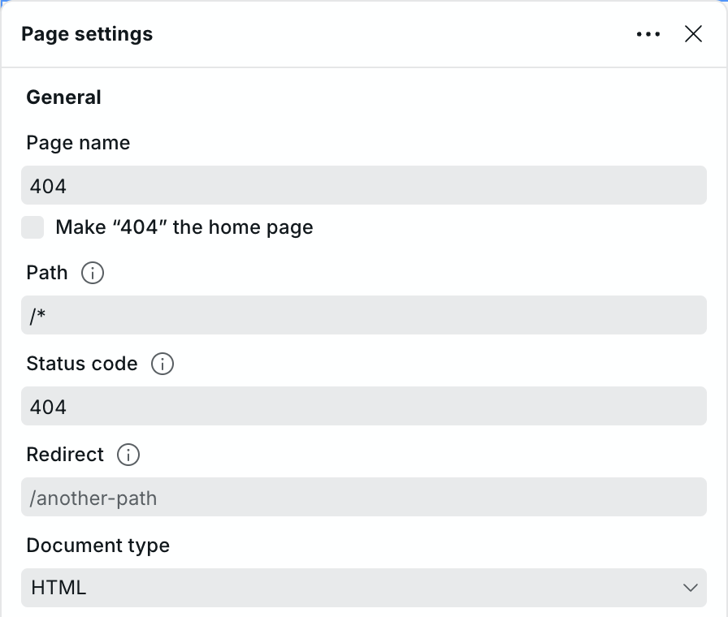

# How to Make a Custom 404 Page

When you visit a URL that doesn't exist or couldn't be found on the server because the webpage was moved or deleted, the broken link redirects to a 404 error page where a message indicating this error is shown.

The default 404 page displays:

> **404 Not Found**

## Creating a Custom 404 Page

If you want to create a customized page for this, you will need to create a new page and change two things:

1. **Change the Status Code** from `200` to `404`
2. **Set the Dynamic Path** to `/*` to catch all non-existent routes

<figure>
  <picture>
    <source media="(prefers-color-scheme: dark)" srcset="../../.gitbook/assets/page-settings-general-dark.png">
    
  </picture>
  <figcaption>
Set the status code to 404 and the path to <code>/*</code>
</figcaption>
</figure>

After that, you can design the page however you like.

## Redirecting to Homepage Instead

If you do not want to show a 404 page error but always redirect to the homepage, you can set the redirect to `/`.

## Related

- [Project settings](../foundations/project-settings.md) – Configure redirects, custom code, and other project-level settings
- [CMS](../foundations/cms.md) – Create dynamic pages that won't trigger 404 errors
- [Variables](../foundations/variables.md) – Use system variables to customize page behavior
